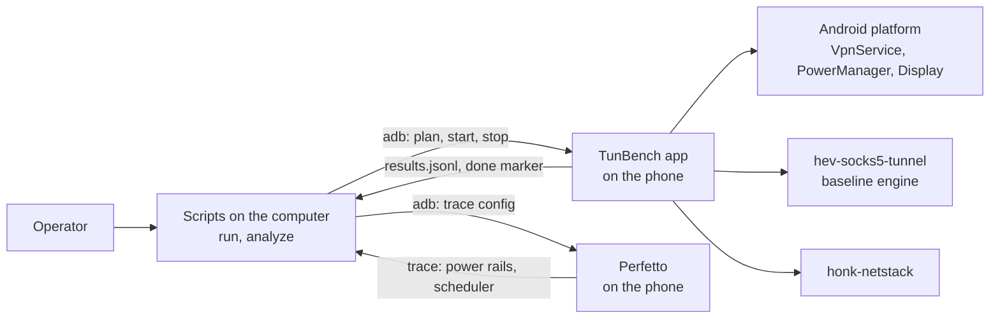
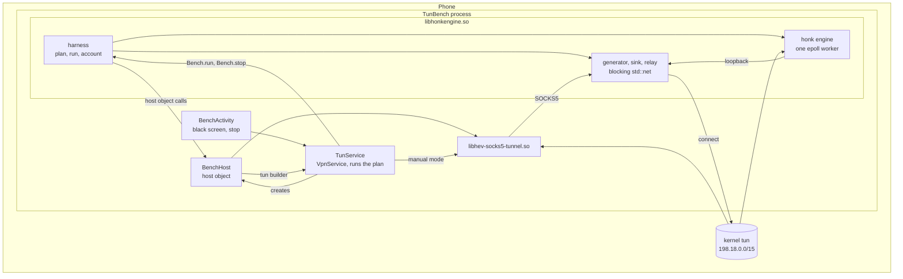
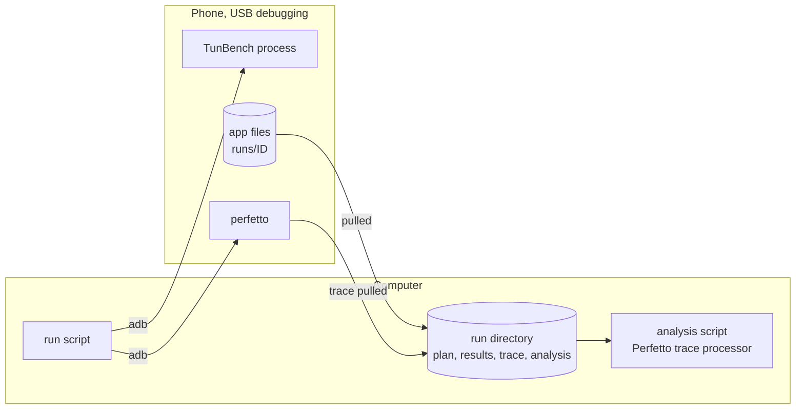

# Android bench harness

The Android bench harness runs a JSON plan inside the TunBench app and writes one JSON line per measurement. It compares honk's Android engine with the baseline engine hev-socks5-tunnel on one phone under identical conditions. Each line holds the CPU time, context switches, tun counters and payload of every role over one window. Scripts on the computer add the energy and wakeups of the same window from one Perfetto trace. A measurement that breaks a validity rule is written as `rejected` with its reasons; the harness never retries, repairs or zero-fills one.

This is test tooling. Nothing here ships in `honk-core`, the figures are not a CI gate, and `honk-android` stays outside the Cargo workspace with its own `Cargo.lock`. The runner is compiled only with the `bench` feature of `honk-android`, which the TunBench build enables. Build and run steps are in [`android/scripts/README.md`](../../../android/scripts/README.md); this page holds the structure and the rules that make the figures valid.

## What it measures

- **Per-core efficiency:** CPU time and energy per gigabyte on known cores.
- **Idle behaviour:** whether the engine goes back to sleep when traffic stops or is sparse.

Throughput is reported, but a VPN on a phone is judged by energy per byte and by how quietly it idles.

Two layers keep the causes apart:

| Layer | Path | Shows |
| --- | --- | --- |
| Stack only | The `tcp_bulk` example of `honk-netstack`: two stacks exchange packets in memory, with no tun, socket or syscall. | The protocol cost alone. |
| VpnService path | Generator, tun, engine, loopback, sink, all inside the TunBench process. This page. | The cost of the integration: tun reads and writes, the engine's event loop and copy path. |

A VpnService figure therefore describes `honk-android`, not `honk-netstack` alone.

## Invariants

Each rule names what breaks when it is violated.

| Invariant | Breaks if violated |
| --- | --- |
| A measurement runs on a fresh tun, sink and engine (and relay, for hev), and only one engine runs at a time. | The engine's process-wide counters, leftover threads or sockets from the previous measurement land in the next window. |
| The four roles (engine, relay, generator, sink) run on pairwise disjoint CPU sets from the plan, and every thread's mask is read back at both ends of the window. | A role that shares a core, or that the scheduler moved, makes the figure depend on placement instead of the engine. |
| Every figure of a window covers the same transfer: counters are read between the window's two boundary timestamps, after the senders stopped and the receivers drained, while every flow thread is still alive. | CPU time per byte divides one interval's CPU time by another interval's bytes; an exited thread takes its CPU time out of the sum. |
| A thread, its mask included, is read only through a handle opened when the window opened, and the engine's threads are listed again when the window closes. | A TID reused by a newer thread silently adds that thread's CPU time to the role; an engine thread started inside the window spends CPU time that no role lists. |
| Nothing in the measured process wakes on its own during `idle` and `sparse`: load roles block without timeouts, sleeps are single waits to a deadline, the runner thread sits on the generator CPUs, and the app polls nothing while a plan runs. | Wakeups and energy caused by the harness are billed to the engine, and idle and sparse measure exactly those. |
| A bulk or sparse measurement passes only if the engine read and wrote tun packets inside the window and the receiver read payload. | A flow that bypassed the engine (VPN down, wrong route) is scored as engine efficiency. |
| Every flow delivers all it sent: each receiver answers its sender with the bytes it read, and a failed read or write, an early end of stream or a mismatching answer breaks the flow. A broken flow rejects bulk, sparse and tail. | A flow that a reset or an error cut short leaves bytes and CPU time of a partial transfer that look like a complete one. |
| The phone is in a valid state at both ends of every window: interactive, display on, bench Activity in front, cpuset unchanged. | A phone that is dimmed, asleep or moved to another cpuset changes placement and throttling; the figure then describes the phone's state. |
| A value the harness cannot read is `null` with a reason, and a sum with a `null` term is `null`. | A guessed zero reads as an engine that costs nothing. |
| The app owns the tun fd, and the engine stops before the fd closes. | An engine reads from a closed or reused fd number. |
| Every wait the runner makes itself is bounded or released: it has a deadline, or the runner's shutdown paths wake the load threads that block without one. Calls into the app and an engine's start are not bounded (see [Limits](#limits)). `stop` ends the current measurement as rejected but still tears it down before `run` returns. | A hung flow holds the phone, its forced-on screen and its VPN; skipped teardown leaves threads that pollute the next run. |
| The runner lives in the one engine library behind a Cargo feature; shipped crates do not depend on it. | Test tooling ships, or a second library brings a second JNI surface and a second set of threads into the measured process. |
| Power windows are cut from the trace by `CLOCK_BOOTTIME` and interpolated at both boundaries; a value the trace cannot support is invalid, not estimated. | Energy depends on where the rail samples happen to fall. |
| Engines are compared inside one run: the schedule interleaves them and reverses their order on even repetitions. | The engine that always runs second inherits the heat and background state of the first, and the difference is credited to the engine. |

## Architecture

### System context



| Element | Responsibility | Does not |
| --- | --- | --- |
| Scripts on the computer | Prepare the phone, deliver the plan, record the trace over the whole run, pull the results, record the stay-awake setting at both ends, compute joules and wakeups per window. | Judge the runner's measurement: they read `status` and `reason`, and judge only the trace values they compute. |
| TunBench app | Own the VPN, the screen and the foreground service; run the plan; write the results, and a reason when it cannot run. | Interpret the figures. |
| Perfetto on the phone | Record power rails and scheduler events with the trace clock `CLOCK_BOOTTIME`. | Know about plans or windows. |
| Android platform | Provide the tun, and the interactive, display and foreground state the runner checks. | Report state unasked; the runner asks at the window ends. |
| hev-socks5-tunnel | The baseline engine, built from a pinned submodule and started through its JNI. | Name its threads: each inherits the name of the thread that started it. |
| `honk-netstack` | The stack under the `honk` engine, as a path dependency. | Know about Android or the harness. |

### Containers



| Container | Responsibility | Does not |
| --- | --- | --- |
| `BenchActivity` | Shows the full-screen black bench screen, keeps the display on, checks that the run can start (no run active, consent granted), starts the bench service with a plain service start. Back and a stop request for the run in progress cancel it through the service (`Bench.stop`) and finish the screen at once; a stop request that starts the Activity finishes it without turning the screen on. | Measure or judge a measurement; show a consent dialog; let a stop request for another run take the screen away. |
| `TunService` | Promotes itself to a `systemExempted` foreground service, runs `Bench.run` on one background thread with a `BenchHost`, supplies the VPN builder, ends the process when the runner left the tun open; also serves the manual mode (one engine started by hand). | Answer the host methods; poll or refresh a UI while a plan runs. |
| `BenchHost` | Answers the host methods the runner calls: establishes and closes the tun for each measurement, starts, stops and reads hev through `TProxyService`, reports the platform state. | Open a tun outside a host call; decide whether a state is valid. |
| `TProxyService` | The JNI entry points of hev. | Get called by the runner directly; `BenchHost` calls it. |
| `MainActivity` | The manual control UI, unchanged and awaiting review. | Take part in a bench run; a run starts through `BenchActivity`. |
| `harness` | Parse and schedule the plan, run each measurement, account per role, reject invalid windows, write the line. | Write `unsafe` code; every system read goes through `sys`. |
| generator, sink, relay | The load: one thread per flow end, blocking sockets, each thread registered under its role. | Time out or poll by themselves. |
| `honk` engine | Terminate every TCP flow on the tun and relay it to the one fixed upstream; ignore UDP. | Know about the plan. |
| `sys` | The one implementation of affinity, thread names, clocks and `/proc` readings (through `procfs`), shared by the manual mode and the harness. | Know about roles, plans or windows. |

### Data flow of one measurement

The generator connects to an address inside the VPN's route; the kernel hands the packets to the tun; the engine reads them and ignores the destination.

- `honk` connects each flow straight to the sink on loopback.
- hev connects each flow to the relay with SOCKS5 `CONNECT`; the relay connects to the same sink. The relay is its own role, so hev's extra user-space hop is visible instead of hidden.
- Up: the generator writes and the sink reads. Down: the sink writes and the generator reads. Payload is counted at the receiving end.

### Deployment



Everything measured runs in one process on the phone. The generator and sink share it with the engine, so no second device or network is involved. The scripts only start and stop, record the trace and read files; they need the phone on USB debugging and no root. The Activity keeps the display on, so the phone stays awake with the bench Activity in front for the whole run. The run script never changes the stay-awake setting. It refuses to start, without waking the phone, if the setting is not off at the start. It records the setting at both ends and fails the run if it is not off at the end. On every exit path the script asks an unfinished run to stop, stops the trace and pulls what exists.

## Measurement

### One measurement in order

1. The app opens a tun with the step's MTU, through the host object (see [Interfaces](#interfaces)).
2. The sink starts, and for hev the relay, each on its pinned CPUs.
3. The engine starts on a thread pinned to the engine CPUs, so every thread the engine creates inherits the mask (for hev also the thread name that identifies its threads).
4. A warmup connection goes through the whole path and the runner waits until the sink read it and it ended at the sink and the relay. A thread the engine starts on first use therefore exists before the window opens.
5. A short quiet time, then the case runs.
6. The engine stops. hev's tun counters are read before that, because its stop resets them. The tun closes, then the relay and sink stop.
7. One line is written, progress is reported, and the plan's cooldown passes before the next step.

The warmup and the connecting of flows, the drain, and the teardown of flows each have a fixed 10 s deadline; a window lasts the plan's seconds.

### Window rules

A window has two boundary timestamps, both `CLOCK_BOOTTIME`, the clock of the Perfetto trace.

- **Order at the start.** The runner reads the platform state, the cpuset and every thread's mask first, then takes the start timestamp, the tun counters and every thread's counters. At the end it reads every thread's counters, the tun counters and the payload, takes the end timestamp, and only then reads the platform state, the cpuset, the engine's threads and the masks again. The probes call into the app and may be slow; they add no CPU time or bytes inside the boundaries.
- **Cut point.** For `bulk` and `sparse` the flows start at a barrier released after the window opened and after the sink accepted every expected connection (hev's start returns once its thread exists, which proves nothing about the data path). The plan's seconds are the sending time. At the cut the senders stop and half-close, and `boottime_cut_ns` records the instant.
- **Drain.** After the cut, the receivers read to the end of what was sent, the runner waits until all of them have, and the window closes with every flow thread still alive. Bytes still in a socket buffer are therefore counted, and a slow counter read afterwards finds no new payload, so no counted byte lacks its CPU time. The span from cut to end belongs to the window, so CPU time and energy include the drain.
- **Delivery.** When the flows end, each receiver answers its sender with the number of bytes it read, and the sender compares it with what it wrote. A flow is broken when a read or write fails at either end (a reset included), the stream ends early or the answer differs from what the sender wrote. In bulk and sparse the flows end after the window has closed, so the answer adds no CPU time or bytes inside it; in tail the burst ends before the window opens. Any broken flow rejects the measurement, in bulk, sparse and tail alike.
- **Same period.** CPU time, context switches, tun counters and payload cover the interval between the two timestamps. The analysis script cuts energy and wakeups from the trace over the same two timestamps.
- **Thread samples.** The threads are read one after another, so a thread's counters begin and end a little inside the window. `scan_start_ns` is the time from the start timestamp to the last thread's first reading, and `scan_end_ns` the time from the first thread's last reading to the end timestamp. A thread's CPU time covers a span that differs from the window by at most these two values at its start and end; the harness records them and does not correct the sums.

### Cases

| Case | Window | Passes when | Main figures |
| --- | --- | --- | --- |
| `bulk` | Barrier, plan seconds, cut, drain. `dir` selects up or down; one measurement per flow count. | Tun reads and writes in the window, and receiver payload. | Payload bytes over the window, CPU time per role, energy per rail. |
| `idle` | The plan's seconds, no flows. | Thread data is readable; no payload is expected, and the analysis checks the rails. | CPU time, switches and wakeups of the quiet engine. |
| `tail` | One up flow for `burst_seconds`; the flow ends; the window opens over the quiet engine and closes `observe_seconds` after the sink read the end of the burst. The sink's mark of that instant is recorded. | The burst's payload reached the receiver, the flow delivered all it sent, and the window opened before the observe period ended. | CPU time and wakeups after traffic stops. |
| `sparse` | One flow writes `bytes` every `interval_ms`; window as `bulk`. | Tun reads and writes, and receiver payload. | Cost per application send; `sends` counts application writes, not packets. |

The harness does not derive the time from the end of a burst to the engine's last wakeup. It records the burst marks and a window that opens after the burst, and counts wakeups in that window.

The tail window opens only after the burst's teardown, so it does not observe the span from the sink's mark to its own start. That prefix is not a rejection reason: the record holds both instants (`tail` and `boottime_start_ns`), and the prefix is the window's start minus the mark. A window that opens at or after the end of the observe period observes nothing and is rejected.

### Rejection reasons

A measurement with any reason is written `rejected`; `reason` joins them. Nothing retries.

| Group | Reasons |
| --- | --- |
| Threads | No engine thread; a thread's mask differs from its role's pin when the window opens; a thread is gone when the window opens or exits inside it; a mask changed or cannot be read; the engine's threads at the end are not those listed at the start, or cannot be listed. |
| Placement | The cpuset cannot be read at either end, or differs between the ends. |
| Platform | Not interactive or the display is not on at either end; the bench Activity is not the top resumed activity at either end; the platform state cannot be read. |
| Route | No tun reads or writes in the window (bulk, sparse); tun counters unreadable or went backwards; no payload at the receiver. |
| Workload | Flows not connected within the setup deadline; flows did not drain; flows did not end in time; some of the flows did not deliver all they sent (`k of n`); the tail window opened at or after the end of its observe period. |
| Accounting | CPU time unreadable for the engine plus relay, the generator or the sink. |
| Setup | The tun, sink, relay or engine did not start; the warmup got no answer or the sink did not receive it; the engine did not stop (this also ends the run, leaving the tun open, and the app ends its process). |
| Stop | `cancelled`. |

Values the harness could not read stay `null`, and `unreadable` lists why.

### Route proof

The generator connects to an address in 198.18.0.0/15, the benchmarking range, which the VPN routes into the tun, and the engine hands every flow to the sink (for hev through the relay) whatever the destination. Payload at the sink therefore crossed the engine. The window's tun counters prove that it did so inside the window: for `honk` the engine's own packet and byte counters, for hev the counters the app reads before the stop. In bench mode the VPN admits only TunBench's own traffic, so other apps' traffic in the same range cannot reach the tun or the counters. `honk` publishes its counters once per poll round, so a read at the end of the window can miss the last round. The tun counters prove the route; they are not used for byte totals, which come from the receiver.

### Platform validity

At both ends of each window the app reports whether the phone is interactive, the state of the default display and whether the bench Activity is the top resumed activity. Only that counts as in front: an Activity that is merely resumed, as in split screen, is not. The report adds the platform build (`SDK_INT_FULL` and build id) and further facts as given, such as the thermal state. It carries no brightness. The runner rejects the window if the phone is not interactive, the display is not on, or the Activity is not in front.

While a plan runs the app shows a full-screen black Activity: pure black, system bars hidden, display kept on, brightness requested at the minimum, shown over the keyguard and turning the screen on. Nothing static is lit. No marker moves, because a moving marker needs periodic wakeups, and `idle` and `sparse` measure wakeups. A tap does not close it; Back or the stop request does. The run script wakes the phone only after it has found the stay-awake setting off. A few seconds after the start it reads the wakefulness, the display state (from the display service, since the power service no longer reports it on Android 17) and the top resumed activity over adb and aborts the run unless the phone is awake, the display is on and the black Activity is on top. It also records the brightness the display applies.

The check runs at the two ends of a window; a loss of state that recovers inside it is not seen.

### Per-thread accounting

- Roles register their own TIDs.
  - Engine: the worker of `honk`; for hev, every thread whose name is the starter's, listed when the window opens and again when it closes.
  - Relay: its acceptor and two threads per connection. They register before the upstream connect, so a sink that accepted a flow proves the accounting lists all the relay's threads for it.
  - Generator: one thread per flow.
  - Sink: its acceptor and one thread per connection.
- Per thread the record holds the TID, name, mask read back, last CPU and CPU time from the scheduler's run time in nanoseconds. Per role it adds user and system ticks, which give only the split (with `USER_HZ` recorded beside them), and voluntary and nonvoluntary context switches.
- The record carries `engine` and `relay` separately and `engine_relay` as their total, so the cost of hev's hop is reported, not absorbed.
- Each thread is opened once, when the window opens, as a handle on its own directory under `/proc/self/task`. Its counters and its mask are read through that handle at both ends, so a TID that a newer thread has reused fails to read instead of being read as the old one. Opening it reads nothing outside that directory, because a read the app may not make is denied and logged inside the window.
- The engine's threads are listed again when the window closes, and a different set rejects the window. The warmup completes the set before the window, so a thread created on first use does not appear later.

### Power windows

The run script records one Perfetto trace over the whole run, with power rails and scheduler events. The analysis refuses a trace whose clock is not `CLOCK_BOOTTIME`. It cuts each record's window `[boottime_start_ns, boottime_end_ns]` from the trace, the same span as the runner's counters, drain included.

- **Joules.** Each rail's cumulative energy counter is interpolated at both boundaries from the samples that bracket them, and the difference is the window's energy. The rails are every counter track of type `power_rails` in the trace (32 on the Pixel 10 Pro), with no names fixed in the code. Tracks are grouped by track id, so two tracks that share a name stay separate rails, keyed `name#id`.
- **Invalid values.** An invalid value is `null` with the reason beside it. A rejected record gets `null` for every value, with its status and reason. A declared rail with no samples, a boundary outside the samples, a counter that went back, or a gap between samples above a threshold makes that rail's joules invalid. The median poll interval is printed.
- **Wakeups.** For each TID of the record, a wakeup is a thread becoming runnable from a sleeping state. A return from preemption or a yield is not counted. Wakeups are invalid for a record when the trace lost scheduler data anywhere (the loss counters carry no time, so the loss voids every window) or when its scheduler data does not span the window, as after the trace size cap. A sleep that ends straight in running, with no runnable state between, is counted too: the waker ran before the sleeper's switch-out was recorded. A role's total is also invalid when one of its threads has no scheduler data in the trace.
- The analysis keeps every field of the runner's line as it is, the cut and the scan bounds included.
- The harness does not claim that USB charging leaves the whole-device rail unaffected.

### Schedule

`interleave` runs, in each repetition, every MTU and case point once per engine back to back, and reverses the engine order on even repetitions. Without it each engine runs all its repetitions before the next engine starts. Report the median and range of at least five repetitions of a figure, never the best run.

## Run plan

The plan is checked once, before anything runs: unknown fields are rejected at every level and values must be inside their ranges. After that the runner trusts it.

```json
{
  "engines": ["hev", "honk"],
  "mtu": [8500],
  "cases": [
    { "kind": "bulk", "dir": "up",   "flows": [1, 4], "seconds": 10 },
    { "kind": "bulk", "dir": "down", "flows": [1, 4], "seconds": 10 },
    { "kind": "idle", "seconds": 60 },
    { "kind": "tail", "burst_seconds": 5, "observe_seconds": 10 },
    { "kind": "sparse", "interval_ms": 1000, "bytes": 64, "seconds": 60 }
  ],
  "pin": { "engine": "7", "generator": "0-1", "relay": "6", "sink": "2-3" },
  "repeat": 5,
  "cooldown_seconds": 30,
  "interleave": true
}
```

- `pin` lists CPU lists that must not overlap; `relay` is required when the plan runs hev. A pin that the app's cpuset narrows shows in the mask read-back and rejects the window instead of being widened.
- MTU values are at least 1280, flow counts 1 to 256, `repeat` 1 to 100, every duration 1 to 3600 s (so a run always ends), `bytes` at most one write buffer (64 KiB).
- `mtu` lists the values to sweep, and every line names the MTU it was taken at.

## Interfaces

### JNI surface

Class `dev.tunbench.Bench`, two static natives. The class loads `libhonkengine.so` itself, so the first call does not depend on the engine class having loaded it.

`run(host, planPath, outDir, runId): String?`

- **Calling thread.** One dedicated background thread of the app, never the main thread. The runner pins that thread to the generator CPUs so its own wakeups stay off the other roles' cores.
- **Concurrency.** One run at a time. The stop flag and the honk engine's counters are process-wide, and the library does not guard a second call.
- **Blocking.** Until the plan ends, `stop` is called or a fatal error occurs. Every wait the runner makes on its own is bounded by the plan's durations or a fixed deadline; calls into the app and the start of an engine are not.
- **Result.** `null` when every step was written; otherwise the reason it stopped (`cancelled` after `stop`). A JNI error or a panic throws `RuntimeException`, so `null` never hides a failure.
- **Files.** It writes the plan copy and `results.jsonl` into `outDir`, and hev's generated config next to them. It writes no other file.

`stop()`

- **Calling thread.** Any thread; it does not block.
- **Effect.** Sets the flag every wait observes. The measurement in progress ends rejected as `cancelled`, is torn down within its deadlines, and `run` returns. Sent before `run`, it cancels that run. The flag clears when a run returns.

### Host object

The runner calls these methods on the host object the app passes to `run`, a `BenchHost`. The host object reports facts and performs actions; it decides nothing about validity.

| Method | Called on | Must | Must not |
| --- | --- | --- | --- |
| `openTun(mtu)` | Runner thread, once per measurement, before the engine starts. | Establish the VPN with the step's MTU, routing only 198.18.0.0/15; return the fd, kept open until `closeTun`, or -1. | Show a dialog or wait for the user (consent is granted before the run); hand the fd to an engine to own. |
| `closeTun()` | Runner thread, after the engine stopped. | Close the fd and release the VPN. | Stop an engine; it only closes the fd. |
| `startHev(configPath, tunFd)` | A native thread pinned to the engine CPUs and named after hev, attached to the JVM for the call. | Start hev with that config on that fd and return once hev's thread exists. | Create hev's threads from any other thread (their mask and name would not match); report success when hev did not start. |
| `stopHev()` | Runner thread. | Wait for hev's thread to end. | Report success while hev may still use the tun; on failure the tun stays open, the run ends and the app ends its process. |
| `hevStats()` | Runner thread, at the start and end of a window, between its timestamps, before `stopHev`. | Return promptly with hev's four tun counters: reads, read bytes, writes, write bytes. | Be called after `stopHev`, which resets them. |
| `platform()` | Runner thread, at both ends of a window, outside its boundaries. | Report the state at the moment of the call; the `interactive`, display and foreground facts must be current. | Answer from a cache, or decide whether the state is valid. |
| `progress(done, total)` | Runner thread, after a line is written and before the cooldown. | Return quickly. | Start periodic work that would run during the next window. |

### App and script contract

A run has an id chosen by the run script. The script grants the VPN consent through the system settings and places the plan in the app's private storage, because the app cannot read the shell's temporary directory. It then wakes the phone and starts the bench Activity with the plan and the run id. A stop request goes to the same Activity and carries the run id: the app cancels only the run with that id, and a request for another run changes nothing.

The app writes, in a directory named after the run id under its private files, the plan copy, `results.jsonl` and a `done` marker, which holds `ok` or the reason the run ended. The marker also answers a start that cannot run:

- Consent is missing: the app writes `VPN consent missing` into `done` and shows no dialog.
- A run is already active: the new run id gets `busy` in its own `done`, and the active run is untouched.
- The runner left the tun open because an engine did not stop: the app writes `done` and ends its process, so the fd and the stale engine threads go with it. Otherwise the next run would count those threads as its own.

The script waits for the marker, then pulls the directory and the trace. If it must end early, it sends the stop request when this run's start was sent and the run's finish was not confirmed. A `done` that appears after the deadline does not confirm it. The script exits 0 only when `plan.json`, a non-empty `results.jsonl`, `done` and the trace were all pulled and `done` holds `ok`. Every adb call has a time limit, so a stuck phone cannot hold the script.

### Result record

One JSON line per measurement.

| Group | Fields |
| --- | --- |
| Identity | `run`, `seq`, `steps`, `case_index`, `rep`, `engine`, `mtu`, `flows`, `case`, `pin`. |
| Window | `boottime_start_ns`, `boottime_end_ns`, `elapsed_ns`, `boottime_cut_ns`, `scan_start_ns`, `scan_end_ns`, `clk_tck`. |
| Load | `bytes` (payload at the receiver), `sends` (sparse), `tail` (`CLOCK_BOOTTIME` marks of the burst's start and of its end at the sink). |
| Roles | `roles.engine`, `relay`, `generator`, `sink`, `engine_relay`: CPU time, user and system ticks, voluntary and nonvoluntary switches, and per thread the TID, name, mask, last CPU and CPU time. |
| Route | `tun` reads, read bytes, writes, write bytes over the window. |
| State | `cpuset_start`, `cpuset_end`, `platform_start`, `platform_end`. |
| Verdict | `status` (`ok` or `rejected`), `reason`, `unreadable`. |

## Decisions not taken

| Pattern | Decision | Why | Revisit when |
| --- | --- | --- | --- |
| A Tokio-based SOCKS5 relay | A blocking `std::net` relay that accepts `CONNECT` only and sends every request to the sink. | Tokio's worker threads and timers would sit inside the measured process and add wakeups to `idle` and `sparse`. | The measured process has a runtime anyway, or the relay must serve more than `CONNECT` to one fixed sink. |
| A separate bench crate or a second JNI library | One library, the runner behind the `bench` feature. | The runner needs the engine's own `sys` accounting without a copy, and a second library adds a second JNI surface and load order. | The runner needs a toolchain or dependency the engine build must not carry, or a second app consumes it. |
| A second `/proc` and affinity implementation | `sys` is the only one; `procfs` is used inside it and nowhere else. | Two parsers drift and give two answers for one thread. | `procfs` lacks a field the accounting needs. |
| Retrying a rejected measurement | Rejected lines stay; the operator repeats the plan. | A retry hides the condition that rejected the first attempt. | A rejection has a cause the harness can remove itself, such as a thermal state it could wait on. |
| Measuring the app in the background | Not built. | The window rules require the bench Activity in front and an unchanged cpuset. | A question about background placement that comes with its own validity rules. |
| Dependency injection, a domain layer or navigation in the app | Not used. | One screen and one service. | A second screen shares state with the service. |
| Convention plugins or a multi-module app | Not used. | One Gradle module. | A second app module exists. |
| Compose and Material 3 for the control UI | The control UI stays on its current views until the maintainer reviews it; the bench screen is not a UI page. | The maintainer reviews the UI first. | The control UI is ported: Compose with Material 3, and the activity-result API for VPN consent. |

## Limits

- The figures describe `honk-android`, a first version with one worker thread on epoll. The in-memory example gives the stack alone.
- Only TCP flows are generated. The path ends at a loopback sink: no outbound protocol, encryption or network cost is in the figures.
- CPU frequency is not fixed (no root). The harness records the cpuset, the platform state and the thermal state it is given, and spaces measurements with the plan's cooldown; it does not verify temperature.
- Power rails are those of the phone's on-device monitor. Another phone may expose other rails or none; the analysis lists every `power_rails` counter track the trace has.
- The runner does not bound a call into the app (`openTun`, `startHev`, `stopHev` and the others) or an engine's start; an app or engine that hangs there holds the run, and `stop` cannot interrupt it.
- The engine's threads are compared at the two ends of a window, as is the platform state: a thread that starts and exits inside the window, or a state lost and recovered inside it, is not seen (see [Per-thread accounting](#per-thread-accounting) and [Platform validity](#platform-validity)).
- The tun counters of `honk` are published once per poll round and can miss the last round of a window (see [Route proof](#route-proof)).
- A stop that arrives between the runner clearing its stop flag and the app marking the run finished survives and cancels the next run at its first step; that run ends `cancelled` with no records. The gap is a few instructions long.
- ABIs other than arm64-v8a and chart output are out of scope.

## Related docs

- [Userspace network stack and WireGuard tunnel](./netstack.md)
- [Android benchmark harness: build and run](../../../android/scripts/README.md)
- [Architecture overview](./overview.md)
