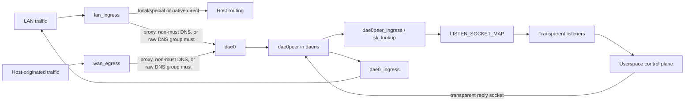

# eBPF kernel datapath

The kernel datapath intercepts traffic. [Control plane](./control-plane.md) describes the userspace path; [NFQUEUE](./nfqueue.md) describes held-first-packet UDP.

## Namespace and hook architecture

The ordinary proxy path redirects packets through an isolated network namespace instead of relying on a host-side TPROXY rule:

### Namespace lifecycle

A throwaway thread calls `unshare(CLONE_NEWNET)`, opens `/proc/thread-self/ns/net`, and hands the resulting `OwnedFd` to the process. That FD pins `daens` for the process lifetime. `/var/run/netns/daens` is only a best-effort compatibility bind mount; the engine does not use it as the namespace owner.

Rtnetlink creates `dae0`/`dae0peer` as an L2 netkit pair when the kernel supports it, otherwise as a veth pair. It moves `dae0peer` by namespace FD and configures links, addresses, neighbors, policy rules, and routes. The addresses are:

| Side | IPv4 | IPv6 |
| --- | --- | --- |
| Host `dae0` | `169.254.0.1/32` | `fd00:686f:6e6b::1/64` |
| `daens` `dae0peer` | `169.254.0.11/32` | `fd00:686f:6e6b::2/64` |

The IPv4 endpoints are separate `/32` addresses, not a shared `/30`. Link-scope routes and static neighbors make the peer reachable. In `daens`, fwmark `TPROXY_MARK` selects table `100`, whose IPv4 and IPv6 local default routes deliver packets to local transparent sockets.

The process otherwise remains in the host namespace. `with_daens_netns` serializes each switch with a process-wide mutex, saves `/proc/thread-self/ns/net`, enters `daens`, runs a fully synchronous closure, and restores the saved namespace on every return or panic path. The closure must never cross `.await` because `setns(2)` is per-thread. A failed restore aborts the process rather than leaving a worker to originate later dials from `daens`.

### Interface hook sets

Ethernet interfaces use the `_l2` programs; interfaces without an Ethernet header use `_l3`. Bridge and bond slaves receive equivalent owned hooks because traffic may bypass a master qdisc.

| Topology | LAN-side hooks | WAN-side hooks |
| --- | --- | --- |
| Dual-homed | `lan_ingress` + `lan_egress` on LAN | `wan_ingress` + `wan_egress` on WAN |
| Single-homed, shared LAN/WAN interface | `lan_ingress` | `wan_egress`; `lan_egress` and `wan_ingress` are skipped |
| WAN-only, no configured LAN interface | None | `wan_ingress` + `wan_egress` |

`lan_ingress` classifies forwarded client traffic. `wan_egress` independently classifies traffic created by the host. The reverse-direction ingress/egress hooks refresh connection state where the topology provides separate directions.

### Dynamic interface reconciliation

`auto` resolves to the current default-route interface. If no default route exists, the entry stays unattached rather than falling back to loopback. `IfaceWatcher` subscribes to rtnetlink link, IPv4/IPv6 address, and IPv4/IPv6 route groups; a 60-second reconciliation tick backs up event delivery. Reconciliation re-resolves `auto`, detects interface recreation by ifindex, recalculates single- versus dual-homed roles, and attaches or forgets process-owned hooks.

A changed link/address/route/interface role updates topology observations, clears health-check cooldowns, and triggers fresh probes. Interface addresses also remain available for ECS; no startup, reload, or network event synthesizes `direct(must)` routing rules or a hidden kernel replacement allowlist. Dead UDP and multi-leaf outbounds remain fail-closed until a fresh probe succeeds; a sole TCP leaf with no `final` remains a userspace last resort.

## Program inventory

| Program | Hook | Kernel responsibility |
| --- | --- | --- |
| `lan_ingress_l2`, `lan_ingress_l3` | TC ingress on LAN | Admission check, special/control-plane and non-DNS local bypass, ordered routing including port-53 ownership, connection state, direct offload, proxy redirect, TX accounting, and optional ambiguous-UDP staging. |
| `wan_ingress_l2`, `wan_ingress_l3` | TC ingress on WAN | Refresh reverse-direction connection state; not attached in a single-homed topology. |
| `lan_egress_l2`, `lan_egress_l3` | TC egress on LAN | Refresh reverse connection state, except that a UDP packet arriving from `dae0` only refreshes an existing entry and never creates one, and suppress locally generated ICMPv6 Redirect packets; skipped on the shared interface in a single-homed topology. |
| `wan_egress_l2`, `wan_egress_l3` | TC egress on WAN | Route host-originated TCP/UDP, apply process-name and control-plane bypass data, check outbound connectivity, cache decisions, and redirect proxy traffic. |
| `dae0_ingress` | TC ingress on host `dae0` | Reverse `REDIRECT_TRACK`, restore original MAC/interface delivery, and count RX traffic. A UDP reply with no exact record falls back to its client's `CLIENT_REPLY_TRACK` framing, uncounted. |
| `dae0peer_ingress` | TC ingress on `daens` `dae0peer` | Restore UDP53 provenance and the SYN incarnation after link scrub; assign only UDP at TC. TCP retains native established/TIME_WAIT lookup before listener selection. |
| `tproxy_sk_lookup` | `sk_lookup` in `daens` | Override ordinary socket lookup with a transparent listener from `LISTEN_SOCKET_MAP`. |
| `tproxy_wan_cg_sock_create` | cgroup `sock_create` | Retain the socket's first process identity; refuse creation if capture fails. |
| `tproxy_wan_cg_connect4`, `tproxy_wan_cg_connect6` | cgroup `connect4`, `connect6` | Preserve existing identity or capture it before connect; refuse connect if capture fails. |
| `tproxy_wan_cg_sendmsg4`, `tproxy_wan_cg_sendmsg6` | cgroup `sendmsg4`, `sendmsg6` | Preserve existing identity or capture it before sending; refuse the send if capture fails. |
| `honk_tcp_v4_route_req`, `honk_tcp_v6_route_req` | Required fentry on TCP request routing | Bind the actual SYN skb's tuple/incarnation and immutable handoff to its actual request socket. |
| `honk_tcp_create_openreq_child` | Required fexit on child creation | Verify the request/child cookie lineage and install the proven handoff in the actual child's socket storage. |
| `honk_tcp_v4_reqsk_destructor`, `honk_tcp_v6_reqsk_destructor` | Required fentry on request destruction | Remove the exact request-address/cookie proof; bounded janitor expiry backs up missed tracing invocations. |

`LISTEN_SOCKET_MAP` keys are fixed: `0` TCP4, `1` TCP6, `2..=5` UDP4, and `6..=9` UDP6. UDP chooses one of four listeners per family with a flow-stable hash. The IPv4 and IPv6 key readers in `tproxy_sk_lookup` remain separate `#[inline(never)]` subprograms. At optimization level 2, inlining lets LLVM turn the family branch into a computed-offset read from the lookup context; the verifier rejects that as a dereference of a modified context pointer.

- TC entry points are raw `#[unsafe(no_mangle)] #[unsafe(link_section = "classifier")]` functions taking `*mut __sk_buff`, not Aya's `#[tc]`, whose structured argument shape triggers a verifier rejection on kernels ≥7.0. Bodies return `Verdict = Result<c_long, c_long>` (`action::Verdict`): `Ok` normal, `Err` early exit; both carry real `TC_ACT_*` values, reduced to kernel `i32` by `flatten` (`action::flatten`). `src/action.rs` owns `TC_ACT_*`. Keep parser and helper sentinels (for example `transport::ERR_FALLBACK`, `ERR_FRAGMENT`, and `PASS_UNSUPPORTED`) separate from verdicts; the `bpf_loop` callback's continuation values are separate as well.
  `src/sk.rs`: `sk_assign_by_index` is TC's counterpart to aya `SockMap::redirect_sk_lookup` (which accepts only `SkLookupContext`); `probe_udp_socket` looks up non-DNS local UDP sockets. All helpers release implicit lookup references. Programs:
    - `lan_ingress_l2/l3` — LAN classify/route/redirect, ordered-policy DNS ownership, `CLASSIFIED_MARK` dedup, and unique-token staging of only ambiguous non-DNS UDP decisions into Pending when NFQUEUE is enabled and ready; enabled-but-not-ready staging fails closed (`src/ingress.rs`).
    - `wan_ingress_l2/l3` — reverse-direction conntrack refresh (skipped single-homed).
    - `lan_egress_l2/l3`, `wan_egress_l2/l3` (`src/egress.rs`) — reverse conn state; locally-originated traffic routing (pname via the actual skb socket's `SOCKET_IDENTITY`, control-plane bypass, `OUTBOUND_CONNECTIVITY_MAP` aliveness, redirect to control plane). Live non-DNS WAN UDP entries take a lookup-only cached-route path; misses route once and then publish complete conntrack metadata.
    - `dae0_ingress` — reply path: rx stats from `RedirectEntry.outbound`, MAC rewrite, redirect to original LAN iface. UDP replies from a peer the client never contacted use the client-only record and are not attributed to an outbound; replies from honk's own link addresses never do.
    - LAN egress suppresses only locally originated ICMPv6 Redirects, using the parser's ICMPv6 header after extension traversal; forwarded Redirects and other ICMPv6 remain pass-through. `honk-core/tests/ebpf_datapath_test.rs` checks L2 through `BPF_PROG_TEST_RUN` and L3 on isolated TUN interfaces, alongside exact-tuple RX accounting and cached-route policy.
    - `dae0peer_ingress` — restores UDP53 route/generation provenance and the TCP SYN incarnation inside `daens`; only UDP uses TC `bpf_sk_assign`. TCP reaches the existing `sk_lookup` listener hook after native established/TIME_WAIT processing.
    - `tproxy_sk_lookup` (`src/sk_lookup.rs`) — transparent listeners: keys 0/1 TCP4/TCP6, 2..5 UDP4, 6..9 UDP6. Keep v4/v6 UDP listener-key reads in `#[inline(never)]` subprograms. At opt-level=2, LLVM if-converts family branches to a load through computed ctx offset, rejected as "dereference of modified ctx ptr". New branch-selected ctx reads must preserve this shape.
    - cgroup sock_create/connect4/6/sendmsg4/6 (`src/cgroup.rs`) — first-captured `SocketIdentity{pid, pname}` retained in native socket storage for process-name rules and control-plane bypass. `pname` is the 15-byte `argv[0]` executable basename read through runtime kernel-BTF offsets, with thread `comm` as the unavailable/read-failure fallback. Kernel socket destruction reclaims the storage; there is no release hook or cookie janitor. Missing required cgroup/storage support aborts startup. Capture failure refuses the operation with `EPERM`, rather than allowing traffic with lost identity.

## Map inventory

`crates/honk-ebpf/src/maps.rs` declares these maps:

| Map | Shape and role |
| --- | --- |
| `CONN_STATE_MAP` | Non-preallocated plain hash, maximum 524,288 entries. Stores a native value lock plus per-flow TCP/UDP state and published routing metadata; userspace owns physical reclamation. |
| `REDIRECT_TRACK` | Non-preallocated 65,536-entry token-bound hash. Locked directional five-tuple payloads retain original MAC/interface, outbound, timestamp and decision identity for reply restoration. |
| `CLIENT_REPLY_TRACK` | 16,384-entry LRU hash. Maps a UDP client address and port for non-53 destinations, including client source port 53, to the framing payload of `REDIRECT_TRACK` with destination zeroed, without its lock header and with token cleared. Replies from uncontacted peers can reach the client without host forwarding. Kernel eviction is approximate: a client that has not sent recently can be evicted before capacity, especially with many CPUs, and such replies then fall back to host forwarding. This cache owns no flow attribution or userspace sweep. |
| `ROUTING_HANDOFF_MAP` | Non-preallocated 65,536-entry hash. TCP SYN handoffs include the committed routing generation; staged UDP carries the decision token. Raw-must UDP53 publishes no tuple handoff: ownership uses per-packet marks. Non-must UDP53 retains facts for malformed-payload fallback. |
| `ROUTING_POLICY_ROOT` | One-entry map-in-map selecting an immutable policy descriptor and one of two synchronous generated-function slots. Successful root replacement supplies the old non-sleepable readers' grace period. |
| Generation-owned IP/MAC indexes | Separate destination/source IPv4 and IPv6 LPM maps plus a MAC LPM map. Values are full per-generation predicate bitmaps, with ancestor bits inherited into more-specific prefixes. |
| Generation-owned domain map | Non-preallocated IP-to-domain-predicate bitmap hash. DNS/sniff facts include positive and negated predicates; a present zero bitmap is known-false. The descriptor exposes its map ID for diagnostics. |
| `OUTBOUND_CONNECTIVITY_MAP` | 1,536-entry array. Six liveness slots per outbound cover TCP/UDP class and IPv4/IPv6; an absent slot is treated as alive. |
| `OUTBOUND_STATS` | 256-entry (`MAX_OUTBOUNDS`) per-CPU array indexed directly by the `u8` outbound index. Each packed 32-byte `OutboundStatsCounters` value contains `tx_packets`, `tx_bytes`, `rx_packets`, and `rx_bytes`; the current ABI does not use `outbound * 4 + counter` indexing. |
| `LISTEN_SOCKET_MAP` | 16-slot `SockMap`; keys `0..=9` hold the two TCP and eight UDP transparent listeners. |
| `DATAPATH_STATE_MAP` | One-slot admission array. Zero passes traffic untouched; nonzero enables classification and redirect. |
| `DATAPATH_FLAGS_MAP` | One-slot runtime policy word: Rule/Direct offload properties plus `global.nfqueue_enable` and NFQUEUE ready fencing. New-flow classification reads it; established direct offload uses cached metadata. |
| `SOCKET_IDENTITY` | Non-cloned `SK_STORAGE` containing the socket's first PID/executable basename. Storage follows the actual socket lifetime, without a fixed hash-entry ceiling or userspace expiry. WAN TC performs lookup only; cgroup create/connect/sendmsg capture missing identity synchronously. |
| `CONN_STATE_OCCUPANCY` | Two-slot per-CPU insert/kernel-delete counters combined with actual userspace delete accounting. Kernel tuple deletion is disabled, so its delete counter remains zero on this path. |
| `BPF_STATS_MAP` | Eight counters: UDP/TCP conn-state overflow, redirect/handoff insertion failures, socket-identity capture refusal, request-proof insertion failure, child-proof storage failure, and SYN-claim failures other than an ordinary same-tuple collision. The janitor warns when the TCP ownership counters grow; `honk-tool bpf stats` prints them. |
| `EVENT_RINGBUF` | 262,144-byte ring of 80-byte events, including functional tuple/incarnation expiry hints. Producers reserve and initialize ring storage directly instead of copying an event through the bounded TC stack. |
| `UDP_DECISION_SEQUENCE` | Persistent one-slot pinned, spin-locked allocator state for NFQUEUE decision identities; protocol details live in [NFQUEUE](./nfqueue.md). |
| `FLOW_INCARNATION_SEQUENCE` | Generation-owned, spin-locked, nonwrapping 56-bit identity domain represented as `u64`; independent of persistent UDP decision tokens. |
| `RETIRE_FENCE`, `RETIRE_ACTIVE` | Non-preallocated 65,536-entry canonical-tuple fence plus one active flag. Each fence retains its unique operation owner and separate decision token. |
| `REQUEST_FENCE` | Non-preallocated 65,536-entry request-address/cookie fence. Janitor request reclamation installs it together with the tuple fence before the same grace period; request hooks check it before borrowing proof storage. |
| `RETIRE_GRACE_ROOT` | Private one-entry map-in-map; successful same-inner replacement synchronously drains pre-fence non-sleepable kernel readers. |
| `TCP_PUBLISHING` | Non-preallocated 65,536-entry same-key SYN publisher exclusion. Ownership lasts one TC invocation; a competing SYN refuses before mutation. No userspace sweep or established-packet acquisition. |
| `TCP_REQUEST_BINDINGS` | Non-preallocated 65,536-entry request-address/cookie hash of immutable SYN proofs. Missing or expired proof cannot be reconstructed from a current tuple. |
| `TCP_SOCKET_BINDING` | Non-cloned socket storage: owned-listener marker or proven child's original tuple/handoff. Userspace reads it by accepted FD before adoption. |
| `TCP_LIVE_PINS` | Non-preallocated 65,536-entry incarnation-to-presence hash. A verified accepted owner acquires one exact pin; only aged TCP lookups consult it. Each guard releases its own incarnation, independent of tuple-local refcounts. |

Kernel/userspace map keys and values are `#[repr(C)]` ABI. IPv4 addresses in shared flow structures are IPv4-mapped IPv6 values in network byte order.

`ConnState`, `RedirectEntry`, and `RoutingHandoffEntry` payloads are 72, 40, and 72 bytes, with independent `incarnation: u64` fields. Their tuple maps store `FlowMapValue<T>`: a native lock at offset 0 and payload at offset 8, giving stored values of 80, 48, and 80 bytes. Payload decision-token offsets are unchanged. `ConnState` also records the original SYN ISN, committed interception/request-history flags and exact request-proof count. `TuplesKey` stays 40 bytes with explicit zeroed trailing padding; `TcpRequestKey` is 16 bytes and the immutable `TcpSocketBinding` payload is 120 bytes, including `syn_isn` at offset 116. The persistent `UDP_DECISION_SEQUENCE` stays exactly 12 bytes. Core validates actual map BTF/value layouts before attachment; the toolbox validates stored layouts before decoding. Use matching core/tool/object versions, not a compatibility shim.

Existing tuple elements are updated in place, never replaced: ordinary Linux hash replacement can recycle storage while an RCU reader still holds its old pointer. Kernel readers take coherent native-lock snapshots or narrow projections; mutations compare the captured identity while locked. No helper is called with a value lock held except unlock. Physical deletion remains under tuple fence, successful kernel grace and post-grace ownership checks. External toolbox enumeration uses bucket-protected batches with locked value copies, not an unsafe singleton fallback.

Stateless UDP tuple metadata uses token/incarnation `0/0`: each newly evaluated packet updates complete handoff/redirect payloads in place only over another `0/0` entry. It cannot overwrite ordinary or staged owners. Raw-must destination-53 traffic keeps its per-packet carrier instead of a tuple handoff. Stateless redirect writes retain the existing timestamp until its refresh cadence is due.

`auxiliary.rs` owns initial and cadence-driven client-only framing publication. Exact LAN UDP traffic to non-53 destinations, including source port 53, can replenish an evicted client record on the existing one-second timestamp-refresh cadence in either direction. The current stored MAC/interface payload is copied under its native lock and projected after unlocking; unknown-peer fallback never renews that cache or gains outbound attribution. This remains best effort, without a new timer or per-packet LRU write.

`RoutingMeta` bit 58 still marks WAN UDP userspace ownership; bit 57 (`OFFLOAD`) distinguishes native direct state. Failed unpublished UDP claims become exact-owner `Aborted` markers with the actually allocated token; they keep their auxiliaries until fenced userspace cleanup. Preparing/Aborted packets cannot renew the claim. Aborted is immediately expiry-eligible, but never forwarded or activated; advisory hint loss still has the existing janitor backstop.

After validating a new object, startup removes only the four obsolete honk pins (`COOKIE_PID_MAP`, `UDP_DECISION_EPOCH`, `UDP_DECISION_INFLIGHT`, `UDP_DECISION_RETIRE_FENCE`). It never sweeps unrelated pins or removes the persistent UDP allocator.

`crates/honk-ebpf-common/src/lib.rs` — shared marks and NFQUEUE token packing, `OutboundIndex`, `RoutingMeta`, `DaeParam`, and `OutboundStatsCounters`/map constants.
`crates/honk-ebpf-common/src/routing_policy.rs` — fixed `RoutingInput`/`RoutingDecision`/`RoutingPolicyDescriptor` ABI (128/24/24 bytes), feature bits, and process-name normalization limits. `RoutingDecision` includes a direct-mark index (`u32::MAX` when absent); the loader rejects older external objects by checking the slot's BTF output layout.
`crates/honk-ebpf-common/src/redirect_need.rs` — `TuplesKey`, `Tuples`, token-carrying `RoutingResult`/`RoutingHandoffEntry`, 256-bit `DomainRouting`, and `SocketIdentity`.
`crates/honk-ebpf-common/src/conn.rs` — `ConnState` (including `UdpDecisionState` and `decision_token`), `ConntrackArgs`, `ParseTransportCtx`, `BpfStatsKey`, and `TcpState`.
`crates/honk-ebpf/src/maps.rs` — static TC map declarations and their kernel-side capacities.
`crates/honk-ebpf/src/flow.rs` owns locked snapshots/projections; `auxiliary.rs` owns matching auxiliary refresh and stable publication.
`crates/honk-ebpf/src/route.rs` — static root/slot facade and fixed-ABI dispatch; generated policy code is loaded by userspace.
`crates/honk-ebpf/src/tcp_binding.rs` and `honk-core/src/ebpf/real/tcp_binding.rs` own the required SYN/request/child bridge and running-kernel BTF validation. The SYN's low 24 mark bits and 32 priority bits carry its 56-bit identity only after peer ingress restores them; TCP has already reused `skb->cb` by request creation. Exhaustion refuses identity publication instead of wrapping.

An intercepted SYN retry looks up the native request or child in the FD-owned `daens`, retaining and releasing the lookup reference around exact proof validation. A live original request keeps its incarnation and original routing snapshot even after policy changes. Before any request has existed, a matching SYN may reuse only a complete, unexpired original publication; sticky request history and exact request counts prevent reuse after destruction. A committed interception with missing handoff/redirect evidence refuses the retry rather than reconstructing ownership or passing it natively. Native-direct flows do not acquire interception proof.

Running-kernel offsets and hook prototypes use the same selected `HONK_VMLINUX_BTF` source as the loader. Referenced requests may inherit SockMap's wrapped protocol, so conversion-helper protocol equality is not request authority. A bounded prefix read uses the existing 328-byte route-witness scratch and clears the whole scratch on success or error; startup rejects field layouts that exceed it. IPv4/child hooks are required at load. IPv6 hooks are required before publishing an actually bound IPv6 TCP listener; only `EAFNOSUPPORT` permits an absent listener. With the installed Aya API, bound modular IPv6 is refused, not silently downgraded: use built-in IPv6 or a genuinely unavailable IPv6 stack. Enabling IPv6 after IPv4-only startup requires a restart.

Owned `daens` disables and verifies SYN cookies, request migration and Fast Open. Only an absent `tcp_syncookies` key is optional for kernels without that feature; inspection, write and verification errors remain fatal. Missing required BTF targets/offsets/attachments refuse startup. Missing, expired, allocation-failed or superseded child proof closes the accepted socket without authorizing tuple deletion. Request proofs expire after 120 seconds; an already proven child's socket storage follows its actual lifetime. Backlog overflow relies on client retry, not guessed cookie attribution.

The ownership checks are inlined into the TC classifiers and raise their verifier cost. On Linux 6.12 `wan_egress_l2` verifies about 556k instructions (over half of the kernel's one-million limit) against about 115k before ownership proofs, and loading the four routing targets accounts for most of the startup time. Changes that add state checks to a classifier should report its `verified_insns` before and after. Outlining a helper into a static or global BPF function did not reduce this cost in measurement: the growth comes from verifier state paths, not duplicated code.

`crates/honk-ebpf-common/src/event.rs`: fixed-layout ring events including conntrack overflow and UDP decision-token exhaustion. `crates/honk-ebpf-common/src/dae_ip.rs`: `In6Addr` union and v4-mapped helpers.
`crates/honk-core/src/routing/ir.rs` — canonical `CompiledPredicate` and userspace `PortRange`; `crates/honk-core/src/control/routing_matcher.rs` lowers them into the generated function ABI.

## Marks and mark ownership

| Constant | Value | Meaning |
| --- | --- | --- |
| `TPROXY_MARK` | `0x08000000` | Selects the `daens` table-100 local-delivery route and tags redirected packets for listener delivery. `global.tproxy_mark` must equal this compiled value. |
| `DAE_BYPASS_MARK` | `0x00000100` | Default when `global.so_mark_from_dae` is zero; otherwise honk sockets and listener recognition use the configured value exactly. |
| `CLASSIFIED_MARK` | `0x40000000` | Prevents a packet attached at both bridge master and slave from being classified twice; also marks final direct verdicts. |
| `NFQUEUE_PENDING_MARK` | `0x80000000` | Identifies traffic that must be held before conntrack/NAT; a valid staged mark also carries `CLASSIFIED_MARK` and a nonzero token. |
| `NFQUEUE_TOKEN_MASK` | `0x3fffffff` | Selects the low 30 skb-mark bits that carry a decision token on NFQUEUE-staged packets. |

`SKB_MARK_RESERVED_MASK` is `0xc0000000`, the union of `CLASSIFIED_MARK` and `NFQUEUE_PENDING_MARK`. Configuration validation rejects `global.so_mark_from_dae` and routing-rule marks that overlap those bits. NFQUEUE direct completion repeats the same check before accepting a rule mark.

Final marked direct packets carry `rule_mark | CLASSIFIED_MARK`, including native LAN, NFQUEUE acceptance and userspace TCP/UDP sockets. Match only user-owned bits in Linux policy rules: `fwmark 0x200/0x3fffffff`. WAN egress bypasses the exact nonzero configured socket mark or a classified mark without `NFQUEUE_PENDING_MARK`; merely containing bit `0x100` is not a bypass. Host-originated nonzero direct marks are sent through userspace, since changing an skb mark at WAN TC is too late for the original Linux route lookup.

Real transparent UDP53 uses `SO_RCVMARK` and per-packet `SOL_SOCKET`/`SO_MARK` ancillary data for DNS/raw ownership. The same skb carries the route code and nonwrapping 20-bit committed routing generation through `cb[2]` across link scrub; mandatory `dae0peer` TC restores it. The signature mask is `0xc8000000` and variable carrier bits are `0x37ffffff`. Bit `0x100` selects an immutable direct-mark index instead of an outbound code; the 8-bit index resolves through the active Router's sorted mark table. Owned `daens` fwmark routing ignores these variable bits. User mark reservations and `UDP_DECISION_SEQUENCE` remain unchanged. Raw direct/group ownership never takes authority from a mutable tuple handoff.

For non-DNS traffic, local-socket probing distinguishes honk's transparent listeners from ordinary local services by comparing the full socket mark with `PARAM.dae_socket_mark`. Host-namespace `dns.bind` sockets are ordinary unmarked listeners, but their presence does not bypass LAN port-53 policy.

## Packet behavior and invariants

### DNS and local-listener precedence

After existing ingress and control-plane exclusions, LAN/WAN TCP/UDP destination port `53` evaluates the normal ordered policy once, not a separate must-only scan. [Traffic-rule ownership](../reference/routing.md#outbound-targets-and-must) determines native, drop, raw, or controller handling. An exact or wildcard local `:53` listener does not override that policy. Port `53` remains exempt from LAN outbound-health drops, not from the selected user `must` result.

The local-socket probe remains before traffic routing only for non-DNS traffic. It uses the packet's current network namespace (negative netns ID), not relative namespace ID `0`. A matching non-honk socket may receive locally; wildcard matches additionally require full FIB `NOT_FWDED`. The existing TCP pure-SYN probe skip remains. For parsed destination `53`, an exact nonzero control-plane bypass mark preserves native request delivery; ordinary requests continue to routing instead of probing a local listener. Backend replies remain subject to existing non-53 policy. There is no unconditional gateway-management reachability guarantee; configure [explicit user rules](../reference/routing.md#explicit-local-rules) when needed.

Native direct is subject to external firewall/NAT; see [DNS source boundaries](./dns.md#ingress-paths) for its distinction from `asis` and client-facing anyfrom replies.

UDP53 stays outside ordinary UDP conn-state and decision-token allocation. Fragmented LAN queries requiring controller/raw delivery use [native reassembly and NFQUEUE](./nfqueue.md#fragmented-lan-dns); unfragmented queries retain TC redirection. A pinned routing-generation counter fences queued metadata across restart without adding a fragment cache or configuration key.

### Special and internal traffic

On LAN ingress/egress and WAN egress, `dst_is_special` passes traffic before routing and conntrack when it sees:

- an L2 destination MAC with the individual/group bit set, covering broadcast and multicast;
- IPv4 `255.255.255.255`, `224.0.0.0/4`, or `0.0.0.0`;
- IPv6 `ff00::/8`.

This keeps DHCP, mDNS, SSDP, LLMNR, and similar link traffic out of the proxy. The internal link address space is `169.254.0.0/16` and `fd00:686f:6e6b::/64`. Control-plane UDP admission rejects proxy initialization when either endpoint is in those ranges, while `dae0`/`dae0peer` hooks handle the engine's own delivery path.

### Outbound liveness

Userspace publishes group-OR health into `OUTBOUND_CONNECTIVITY_MAP`. A new LAN flow routed to a slot explicitly marked dead is dropped with `TC_ACT_SHOT`; this is deliberately fail-closed. One narrow exception keeps the slot open for a TCP group with exactly one unique leaf and no `final`, allowing a real dial through that same proxy to prove recovery without an implicit `direct` fallback. UDP and all-dead multi-leaf groups remain fail-closed, while a group containing a `direct`/`block` builtin never goes dead: the builtins are never marked dead, so the group-OR slot stays alive. TCP and UDP destination port `53` are exempt from LAN health drops, subject to the DNS ownership rules above. Gateway-native routing requires user-authored rules rather than generated interface-address rules.

### Route-time direct offload

For non-DNS traffic, the decision to keep a non-`must` flow in kernel direct routing is made once and cached in `RoutingMeta` bit 57. Established packets test the cached bit instead of rereading `DATAPATH_FLAGS_MAP`. Direct-mode offload cannot take ownership from non-`must` DNS.

| Effective mode | Route-time policy |
| --- | --- |
| `Rule` (also no Clash mode override) | A non-`must` `direct` result is offloaded only when SNI cannot change it: no domain-class reevaluation is possible, DNS learning supplied the flow's domain bitmap, or the matching direct action has no live domain predicate in its rule prefix including itself. Domain rules after that first match do not prevent offload; earlier or current unresolved domain predicates remain conservative. |
| `Direct` | LAN ingress, WAN TCP and WAN UDP normalize every non-`must`, non-`block` flow to `direct` and offload it; no proxy health gate applies. A rule mark is kept only when the rule itself routed `direct`. Unlike the userspace override, SNI is not consulted, so a `block` or `must` rule reachable only through a sniffed domain does not apply. |
| `Global` | An exact global selection of `direct` uses the same all-direct policy. Other global selections keep non-final flows in userspace for the selected outbound. |

`direct(must)` always stays direct and needs no bit-57 flag. Ordinary non-DNS `block` and `block(must)` remain final; non-`must` DNS instead retains controller ownership. Full rule evaluation and mode semantics are documented in [Routing](./routing.md).

### Host-originated WAN UDP

`wan_egress` only classifies locally generated traffic; forwarded packets have a real ingress ifindex and pass untouched. Honk-owned marked sockets and matching control-plane socket identity also bypass it. For a live non-DNS UDP flow with published connection state, the program uses a lookup-only cached-route path. A miss runs routing once and publishes complete state before subsequent packets use the cache. DNS remains short-lived and does not create this UDP cache entry. If preparing the redirect fails (a full or mismatched handoff/redirect map), WAN TCP and UDP packets are dropped rather than passed natively; the existing insertion-failure counters record full maps.

## Admission sequencing

`DATAPATH_STATE_MAP[0]` stays zero while hooks attach. TC programs pass traffic untouched in that state. The control plane binds listeners, atomically publishes the complete TCP/UDP FD set, starts receive loops, establishes any enabled NFQUEUE readiness, and only then writes a nonzero admission value. A partial listener generation therefore cannot redirect traffic to an absent socket.

Shutdown fences new NFQUEUE staging where applicable, closes `DATAPATH_STATE_MAP[0]` before listener teardown, then drains and detaches producers. Admission-map failure is fatal rather than silently continuing with ambiguous ownership.

## Userspace maintenance and accounting

`BpfJanitor` wakes every two seconds. Accepted TCP relays pin their `CONN_STATE_MAP` and `REDIRECT_TRACK` entries for the relay lifetime. Unpinned TCP closing state expires after 10 seconds; unpinned active TCP and UDP state use a 120-second backstop.

Conn-state sweeps normally run every 60 seconds. At 70% occupancy the interval falls to 15 seconds; at 85% it enters pressure mode and sweeps every two-second tick. Growth in kernel overflow counters also activates pressure mode as the fail-closed last resort. `CONN_STATE_OCCUPANCY` combines per-CPU kernel inserts/deletes with userspace delete accounting and exact sweep recalibration. Bounded auxiliary-map scans (`REDIRECT_TRACK`, `ROUTING_HANDOFF_MAP`) use the aggressive 8-second cleanup cadence when the latest scan is incomplete or covers at least 85% of the 65,536-entry map. Socket identity is never swept.

Kernel expiry emits an advisory hint and refuses the triggering packet; it no longer performs lookup-then-delete. The existing removal worker multiplexes TCP, UDP and expiry work in bounded batches of at most 128. It acquires each tuple fence once, completes one kernel grace period, revalidates captured ownership/expiry, and releases only its own fences. Hints bypass diagnostic log throttling; ring/queue pressure can lose hints, with the ordinary sweep as backstop. No universal prompt-recovery bound is claimed under overload.

Janitor conn/redirect/handoff/request-proof cleanup and staged UDP commits use the same exclusion. Current TCP pins are checked under the backend write lock, which also excludes new adoption. Partial deletions remain accounted even on error; unresolved fence ownership inhibits admission and is fatal. Admitted worker/janitor cleanup is joined beyond the shutdown warning, never abandoned by a timeout.

Per-outbound traffic counters are per CPU. TX packets and bytes are counted at `lan_ingress` when the route lands, for both redirect and direct-offload outcomes. RX packets and bytes are counted at `dae0_ingress` after `REDIRECT_TRACK` identifies the returning outbound; a reply delivered from `CLIENT_REPLY_TRACK` has no returning outbound and is not counted. Unclassified pass-through traffic and drops have no outbound counter.

The backend API uses `TuplesKey`/`ConnState`, bounded map scans, and conditional retirement. Legacy `ConnTuple` CRUD, string IP/domain routes, cached parameter setters, and backend statistics adapters are removed. Load-time `DaeParam` globals, generation-owned IP/MAC/domain fact maps, `StatsManager`, and pinned `OUTBOUND_STATS` remain the authoritative paths.

`just test-netns` includes production TC packet regressions: exact reverse-tuple RX accounting, cached-route health/readiness, and locally generated ICMPv6 Redirect suppression. L2 cases use `BPF_PROG_TEST_RUN`; L3 uses actual TUN interfaces in an isolated network namespace, including forwarded and hook-detached controls.

## Related docs

- [Routing design](./routing.md)
- [NFQUEUE held-packet path](./nfqueue.md)
- [Control plane](./control-plane.md)

