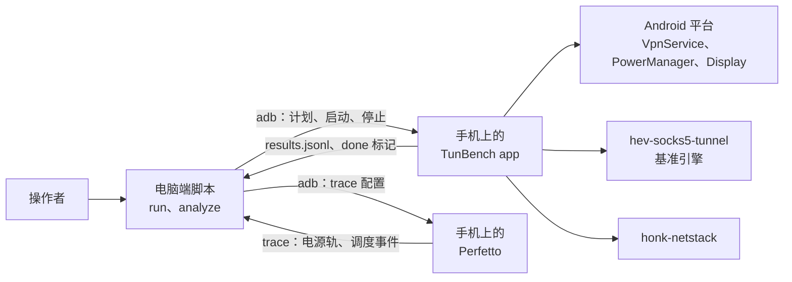
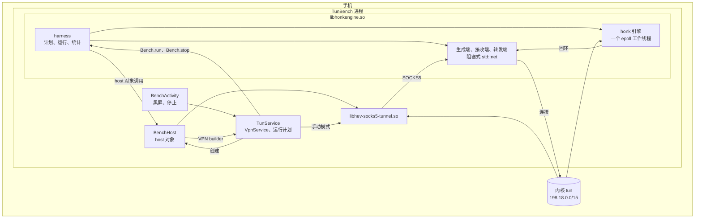
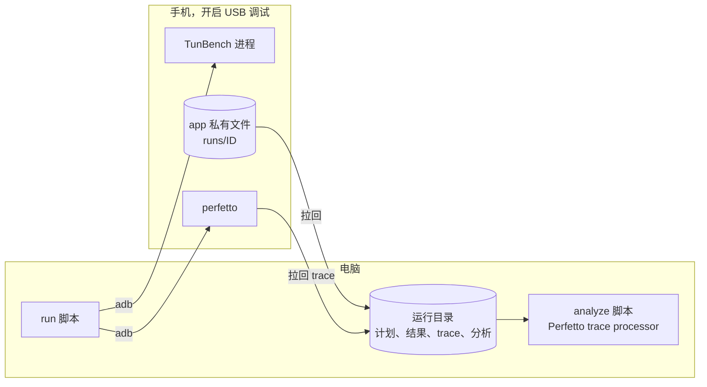

# Android 基准测试工具

Android 基准测试工具在 TunBench app 内运行 JSON 测试计划，每次测量写出一行 JSON。它让 honk 的 Android 引擎与基准引擎 hev-socks5-tunnel 在同一部手机、相同条件下比较。每行记录一个窗口内各角色的 CPU 时间、上下文切换、tun 计数器和载荷。电脑端脚本再用一份 Perfetto trace 补上该窗口的能耗和唤醒次数。违反有效性规则的测量写为 `rejected` 并附原因；工具从不重试、修补或补零。

这是测试工具：不随 `honk-core` 发布，数据不作 CI 门禁，`honk-android` 位于 Cargo workspace 之外，有自己的 `Cargo.lock`。运行器只在启用 `honk-android` 的 `bench` feature 时编译，由 TunBench 构建启用。构建和运行步骤见 [`android/scripts/README.md`](../../../android/scripts/README.md)；本页说明结构，以及保证数据有效的规则。

## 测量什么

- **每核效率：** 在已知核心上，每 GB 消耗的 CPU 时间和能耗。
- **idle 行为：** 流量停止或稀疏时，引擎是否回到睡眠。

吞吐量也会报告，但手机上的 VPN 看的是每字节的能耗，以及闲置时是否安静。

两层测量把原因分开：

| 层 | 路径 | 反映 |
| --- | --- | --- |
| 仅协议栈 | `honk-netstack` 的 `tcp_bulk` 示例：两个栈在内存里互传报文，没有 tun、socket 和系统调用。 | 单独的协议成本。 |
| VpnService 路径 | 生成端、tun、引擎、回环、接收端，全部在 TunBench 进程内。本页的对象。 | 集成的成本：tun 读写、引擎的事件循环和复制路径。 |

因此 VpnService 路径的数据描述的是 `honk-android`，不只是 `honk-netstack`。

## 不变量

每条规则都写明违反后的后果。

| 不变量 | 违反后的后果 |
| --- | --- |
| 每次测量使用新的 tun、接收端和引擎（hev 另有转发端），同一时刻只运行一个引擎。 | 引擎的进程级计数器，以及上一次测量遗留的线程或 socket，落进下一个窗口。 |
| 四个角色（引擎 `engine`、转发端 `relay`、生成端 `generator`、接收端 `sink`）使用测试计划给出且两两不相交的 CPU 集合，并在窗口两端回读每个线程的掩码。 | 与其他角色共用核心，或被调度器迁走，会使结果取决于线程放置而不是引擎。 |
| 窗口内所有数据覆盖同一次传输：计数器在窗口的两个边界时间戳之间读取，此时发送端已停止、接收端已排空，所有 flow 线程仍存在。 | 每字节 CPU 时间变成一段时间的 CPU 时间除以另一段时间的字节数；已退出的线程会从求和中消失。 |
| 线程（包括它的掩码）只通过窗口打开时取得的句柄读取，窗口关闭时再次列出引擎的线程。 | 被新线程复用的 TID 会把该线程的 CPU 时间悄悄算进角色；窗口内新启动的引擎线程消耗的 CPU 时间不属于任何角色。 |
| 被测进程内的任何部分在 `idle` 和 `sparse` 期间都不自行唤醒：负载角色不带超时地阻塞，睡眠只是等到一个 deadline 的单次等待，运行器线程绑在生成端的 CPU 上，测试计划运行期间 app 不做任何轮询。 | 工具自身引起的唤醒和能耗被算到引擎头上，而 `idle` 和 `sparse` 测的正是这些。 |
| bulk 或 sparse 测量只有在窗口内引擎读写了 tun 报文、且接收端读到载荷时才通过。 | 绕过引擎的流（VPN 未启动、路由错误）会被记为引擎的效率。 |
| 每条 flow 都交付了它发送的全部数据：接收端把读到的字节数回复给发送端，读写失败、流提前结束或回复不一致，都使该 flow 失效；任何失效的 flow 都使 bulk、sparse 和 tail 被拒绝。 | 被重置或出错截断的 flow 留下的字节数和 CPU 时间只是部分传输，看起来却像完整传输。 |
| 手机在每个窗口的两端都处于有效状态：处于交互状态、屏幕点亮、`BenchActivity` 在前台、cpuset 未变。 | 变暗、休眠或被移到其他 cpuset 的手机会改变线程放置和降频，数据此时描述的是手机状态。 |
| 工具无法读取的值写为 `null` 并附原因，含 `null` 项的求和也是 `null`。 | 猜出来的 0 会被读成引擎没有任何开销。 |
| tun 文件描述符由 app 持有，引擎先停止，之后才关闭该描述符。 | 引擎读写一个已关闭或已被复用的描述符编号。 |
| 运行器自己发起的每个等待都有界或被解除：它带 deadline，或由运行器的关闭路径唤醒不带 deadline 而阻塞的负载线程。对 app 的调用和引擎的启动不受限制（见[限制](#限制)）。`stop` 把当前测量记为被拒绝，并在 `run` 返回前完成拆除。 | 卡住的 flow 会占住手机、强制点亮的屏幕和 VPN；跳过拆除会留下影响下一次运行的线程。 |
| 运行器位于唯一的引擎库内，由 Cargo feature 控制；发布的 crate 不依赖它。 | 测试工具被发布，或第二个库把第二套 JNI 接口和第二组线程带进被测进程。 |
| 电源窗口按 `CLOCK_BOOTTIME` 从 trace 中切出，并在两个边界上插值；trace 支撑不了的值标为无效，不做估算。 | 能耗取决于电源轨采样点恰好落在哪里。 |
| 引擎在同一次运行内比较：调度表交错安排各引擎，偶数轮反转顺序。 | 总是排在后面的引擎继承前一个引擎留下的温度和后台状态，差异被记到引擎头上。 |

## 架构

### 系统上下文



| 组成 | 职责 | 不做 |
| --- | --- | --- |
| 电脑端脚本 | 准备手机，投送测试计划，在整次运行内录制 trace，拉回结果，在两端记录常亮设置，按窗口计算焦耳数和唤醒次数。 | 评判运行器的测量：只读取 `status` 和 `reason`，只评判自己从 trace 算出的值。 |
| TunBench app | 持有 VPN、屏幕和前台服务；运行测试计划；写出结果，无法运行时写出原因。 | 解读数据。 |
| 手机上的 Perfetto | 以 `CLOCK_BOOTTIME` 为 trace 时钟，记录电源轨和调度事件。 | 了解测试计划或窗口。 |
| Android 平台 | 提供 tun，以及运行器检查的交互、屏幕和前台状态。 | 主动上报状态；运行器在窗口两端询问。 |
| hev-socks5-tunnel | 基准引擎，由固定版本的 submodule 构建，经其 JNI 启动。 | 给自己的线程命名：每个线程继承启动它的线程的名字。 |
| `honk-netstack` | `honk` 引擎使用的协议栈，以 path 依赖引入。 | 了解 Android 或测试工具。 |

### 容器



| 容器 | 职责 | 不做 |
| --- | --- | --- |
| `BenchActivity` | 显示全屏黑色测试屏，保持屏幕常亮，检查运行能否开始（没有活动中的运行，授权已就绪），以普通的 service 启动方式启动测试服务。返回键和针对当前运行的停止请求经由服务取消该运行（`Bench.stop`），并立即结束该屏幕；由停止请求启动的 Activity 立即结束，不点亮屏幕。 | 测量，或评判测量；弹出授权对话框；让针对其他运行的停止请求收走屏幕。 |
| `TunService` | 自行提升为 `systemExempted` 前台服务，在一个后台线程上用 `BenchHost` 运行 `Bench.run`，提供 VPN builder，运行器让 tun 保持打开时结束进程；同时提供手动模式（手动启动一个引擎）。 | 响应 host 方法；在测试计划运行期间轮询或刷新界面。 |
| `BenchHost` | 响应运行器调用的 host 方法：为每次测量建立并关闭 tun，经由 `TProxyService` 启动、停止和读取 hev，上报平台状态。 | 在 host 调用之外打开 tun；判断状态是否有效。 |
| `TProxyService` | hev 的 JNI 入口。 | 被运行器直接调用；由 `BenchHost` 调用它。 |
| `MainActivity` | 手动控制界面，保持不变，等待审阅。 | 参与测试运行；运行从 `BenchActivity` 启动。 |
| `harness` | 解析并编排测试计划，运行每次测量，按角色统计，拒绝无效窗口，写出结果行。 | 编写 `unsafe` 代码；所有系统读取都经过 `sys`。 |
| 生成端、接收端、转发端 | 负载：每个 flow 的每一端一个线程，阻塞式 socket，每个线程登记在自己的角色下。 | 自行超时或轮询。 |
| `honk` 引擎 | 终结 tun 上的每条 TCP flow，转发到唯一固定的上游；忽略 UDP。 | 了解测试计划。 |
| `sys` | 亲和性、线程名、时钟和 `/proc` 读取（经由 `procfs`）的唯一实现，手动模式和测试工具共用。 | 了解角色、测试计划或窗口。 |

### 一次测量的数据流

生成端连接到 VPN 路由范围内的一个地址，内核把报文交给 tun，引擎读出报文并忽略目的地址。

- `honk` 把每条 flow 直接连到本机回环上的接收端。
- hev 用 SOCKS5 `CONNECT` 把每条 flow 连到转发端，转发端再连到同一个接收端。转发端是独立的角色，因此 hev 多出的用户态一跳是可见的，不会被隐藏。
- 上行：生成端写、接收端读。下行：接收端写、生成端读。载荷在接收端计数。

### 部署



被测的一切都在手机上的同一个进程内运行。生成端和接收端与引擎同处一个进程，因此不涉及第二台设备或网络。脚本只负责启动和停止、录制 trace 和读取文件；它们需要手机开启 USB 调试，不需要 root。Activity 保持屏幕常亮，因此整次运行期间手机保持唤醒，bench Activity 停在前台。run 脚本从不修改常亮设置：开始时该设置不为 0，它拒绝启动且不唤醒手机；它在开始和结束时记录该设置，结束时若不为 0 则判本次运行失败。在每条退出路径上，脚本都会让未结束的运行停止，停止 trace 并拉回已有的内容。

## 测量

### 一次测量的顺序

1. app 按本步骤的 MTU 打开 tun，经由 host 对象完成（见[接口](#接口)）。
2. 接收端启动，hev 另有转发端，各自绑定到自己的 CPU。
3. 引擎在绑定到引擎 CPU 的线程上启动，因此引擎创建的每个线程都继承该掩码（hev 的线程还继承用来识别它们的线程名）。
4. 一条预热连接走完整条路径，运行器等待接收端读完它，并等它在接收端和转发端都已结束。引擎在首次使用时才创建的线程因此在窗口打开前就已存在。
5. 一小段静默时间，然后运行测试项。
6. 引擎停止。hev 的 tun 计数器在此之前读取，因为 hev 停止时会清零。随后关闭 tun，再停止转发端和接收端。
7. 写出一行结果，上报进度，经过测试计划的冷却间隔后进入下一步。

预热、flow 建立、排空和 flow 拆除各有固定 10 秒的 deadline；窗口长度为测试计划给定的秒数。

### 窗口规则

窗口有两个边界时间戳，都取 `CLOCK_BOOTTIME`，即 Perfetto trace 使用的时钟。

- **起点的顺序。** 运行器先读取平台状态、cpuset 和每个线程的掩码，再取起始时间戳、tun 计数器和每个线程的计数器。终点先读每个线程的计数器、tun 计数器和载荷，取结束时间戳，之后才再次读取平台状态、cpuset、引擎的线程和掩码。这些探测会调用 app，可能较慢；它们不会给边界之内增加 CPU 时间或字节。
- **截止点。** 对 `bulk` 和 `sparse`，flow 在一个屏障处同时开始。屏障在窗口打开之后、接收端接受了全部预期连接之后才放开（hev 的启动在其线程创建后就返回，这并不能证明数据路径可用）。测试计划的秒数是发送时间。到达截止点时发送端停止并半关闭，`boottime_cut_ns` 记录这一时刻。
- **排空。** 截止之后，接收端把已发送的数据读到末尾，运行器等待全部接收端完成，窗口在所有 flow 线程仍存在时关闭。因此仍在 socket 缓冲区中的字节会被计入；排空之后读取计数器即使较慢，也不会再有新载荷，窗口不会漏掉已计载荷对应的 CPU 时间。从截止到结束的这段时间属于窗口，所以 CPU 时间和能耗包含排空阶段。
- **交付。** flow 结束时，每个接收端把读到的字节数回复给发送端，发送端与自己写出的字节数比较。读或写在任一端失败（包括被重置）、流提前结束，或回复与发送端写出的不一致，该 flow 即失效。bulk 和 sparse 的 flow 在窗口关闭之后才结束，因此回复不会给窗口内增加 CPU 时间或字节；tail 的突发在窗口打开之前就已结束。任何 flow 失效，bulk、sparse 和 tail 的测量都被拒绝。
- **同一时段。** CPU 时间、上下文切换、tun 计数器和载荷都覆盖两个时间戳之间的区间。analyze 脚本按同样两个时间戳从 trace 中切出能耗和唤醒次数。
- **线程采样。** 线程是逐个读取的，因此每个线程的计数器起止都略在窗口之内。`scan_start_ns` 是起始时间戳到最后一个线程的首次读取之间的时间，`scan_end_ns` 是第一个线程的最后一次读取到结束时间戳之间的时间。线程 CPU 时间覆盖的区间在起点和终点最多与窗口相差这两个值；工具记录它们，不修正求和。

### 测试项

| 项目 | 窗口 | 通过条件 | 主要指标 |
| --- | --- | --- | --- |
| `bulk` | 屏障、计划给定的秒数、截止、排空。`dir` 选择上行或下行；每个 flow 数各产生一次测量。 | 窗口内有 tun 读写，且接收端有载荷。 | 窗口内的载荷字节数、各角色 CPU 时间、各电源轨能耗。 |
| `idle` | 计划给定的秒数，没有 flow。 | 线程数据可读；不要求载荷，电源轨由 analyze 检查。 | 静默引擎的 CPU 时间、切换次数和唤醒次数。 |
| `tail` | 一条上行 flow 持续 `burst_seconds`；flow 结束；窗口在静默引擎上打开，并在接收端读到突发末尾后 `observe_seconds` 关闭。接收端记录该时刻。 | 突发的载荷到达了接收端，该 flow 交付了它发送的全部数据，窗口在观察期结束之前打开。 | 流量停止后的 CPU 时间和唤醒次数。 |
| `sparse` | 一条 flow 每隔 `interval_ms` 写 `bytes` 字节；窗口同 `bulk`。 | 有 tun 读写，且接收端有载荷。 | 每次应用发送的成本；`sends` 统计应用写入次数，不是报文数。 |

工具不推导从突发结束到引擎最后一次唤醒的时间。它记录突发的时间标记和一个在突发之后打开的窗口，并统计该窗口内的唤醒次数。

tail 窗口在突发拆除之后才打开，因此从接收端的标记到窗口起点这段时间不在观察之内。这段前缀不是拒绝原因：记录里有两个时刻（`tail` 和 `boottime_start_ns`），前缀就是窗口起点减去该标记。窗口在观察期结束时或之后才打开，什么也观察不到，会被拒绝。

### 拒绝原因

带有任何原因的测量写为 `rejected`；`reason` 把这些原因连起来。不会重试。

| 类别 | 原因 |
| --- | --- |
| 线程 | 没有引擎线程；窗口打开时线程的掩码与其角色的绑定不一致；线程在窗口打开时已不存在，或在窗口内退出；掩码发生变化或无法读取。窗口结束时引擎的线程与起点列出的不一致，或无法列出。 |
| 放置 | 任一端的 cpuset 无法读取，或两端不一致。 |
| 平台 | 任一端不处于交互状态或屏幕未点亮；任一端 `BenchActivity` 不是处于恢复状态的顶层 activity；无法读取平台状态。 |
| 路由 | 窗口内没有 tun 读写（bulk、sparse）；tun 计数器不可读或倒退；接收端没有载荷。 |
| 负载 | flow 未在建立 deadline 内连接；flow 未排空；flow 未在时限内结束；部分 flow 没有交付它们发送的全部数据（`k of n`）；tail 窗口在观察期结束时或之后才打开。 |
| 统计 | 引擎加转发端、生成端或接收端的 CPU 时间不可读。 |
| 准备 | tun、接收端、转发端或引擎未能启动；预热没有应答，或接收端没有收到；引擎没有停止（这也会结束整次运行，保留 tun 打开，app 随即结束自己的进程）。 |
| 停止 | `cancelled`。 |

工具无法读取的值保持 `null`，`unreadable` 列出原因。

### 路由证明

生成端连接 198.18.0.0/15 内的一个地址，这是基准测试专用网段，VPN 把它路由进 tun；引擎不管目的地址，把每条 flow 交给接收端（hev 经转发端）。因此接收端的载荷一定经过了引擎。窗口内的 tun 计数器证明这发生在窗口之内：`honk` 用引擎自己的报文和字节计数器，hev 用 app 在停止前读取的计数器。基准测试模式下，VPN 只放行 TunBench 自己的流量，所以同一网段内其他 app 的流量不会进入 tun，也不会计入计数器。`honk` 每个轮询周期发布一次计数器，窗口结束时的读取可能漏掉最后一个周期。tun 计数器证明路由，不用于字节总数，字节总数来自接收端。

### 平台有效性

每个窗口的两端，app 上报手机是否处于交互状态、默认屏幕的状态，以及 `BenchActivity` 是否为处于恢复状态的顶层 activity，这就是这里所说的在前台；仅处于恢复状态（例如分屏）不算。它还附上平台构建信息（`SDK_INT_FULL` 和 build id）以及按原样给出的其他信息，例如温度状态。它不上报亮度。如果手机不处于交互状态、屏幕未点亮，或 `BenchActivity` 不在前台，运行器拒绝该窗口。

测试计划运行期间，app 显示全屏黑色 Activity：纯黑、隐藏系统栏、保持屏幕常亮、请求最低亮度，并显示在锁屏之上、点亮屏幕。没有任何静态内容被点亮。界面上没有移动的标记，因为移动标记需要周期性唤醒，而 `idle` 和 `sparse` 测量的正是唤醒。点按不会关闭它，返回键或停止请求才会。

run 脚本确认常亮设置为关闭之后才唤醒手机。启动几秒后，它经 adb 读取唤醒状态、屏幕状态和顶层 activity，手机未唤醒、屏幕未点亮或黑色 Activity 不在顶层时中止运行。屏幕状态取自 display 服务，因为 Android 17 的 power 服务不再报告它。它还记录屏幕实际应用的亮度。

检查只在窗口的两端进行；窗口内发生又恢复的状态丢失不会被发现。

### 逐线程统计

- 各角色登记自己的 TID。
  - 引擎：`honk` 的工作线程；hev 则是名字与启动线程相同的所有线程，在窗口打开和关闭时各列出一次。
  - 转发端：acceptor 线程，加每条连接的两个线程。它们在连接上游之前登记，因此接收端已接受某条 flow，就证明统计已列出该 flow 在转发端的全部线程。
  - 生成端：每条 flow 一个线程。
  - 接收端：acceptor 线程，加每条连接一个线程。
- 每个线程记录 TID、名字、回读的掩码、最后运行的 CPU，以及按调度器运行时间（纳秒）得到的 CPU 时间。每个角色另有 user 和 system tick（只用于区分两者，旁边记录 `USER_HZ`），以及主动和被动上下文切换次数。
- 记录中 `engine` 和 `relay` 分别给出，`engine_relay` 是两者之和，因此 hev 多出一跳的成本被如实报告，不会被吞掉。
- 每个线程在窗口打开时只打开一次，得到 `/proc/self/task` 下它自己目录的句柄；两端的计数器和掩码都经由该句柄读取，因此被新线程复用的 TID 读取失败，不会被当作旧线程。打开句柄不读取该目录之外的任何文件，因为 app 无权的读取会被拒绝，并在窗口内留下日志记录。
- 窗口关闭时再次列出引擎的线程，集合不同则拒绝该窗口。预热让线程集合在窗口之前就完整，所以首次使用时才创建的线程不会在之后出现。

### 电源窗口

run 脚本在整次运行内录制一份 Perfetto trace，含电源轨和调度事件。analyze 拒绝时钟不是 `CLOCK_BOOTTIME` 的 trace。它按每条记录的窗口 `[boottime_start_ns, boottime_end_ns]` 切取 trace，与运行器的计数器覆盖同一段时间，排空阶段也在其内。

- **焦耳数。** 每条电源轨的累计能量计数器，在两个边界上用前后相邻的采样点插值，两者之差就是窗口内的能耗。电源轨是 trace 中类型为 `power_rails` 的全部计数器 track（Pixel 10 Pro 上为 32 条），代码里不写死名称。电源轨按 track id 分组，名称相同的两条 track 仍是两条电源轨，以 `名称#id` 区分。
- **无效值。** 无效值为 `null`，旁边写明原因。被运行器拒绝的记录，所有值都为 `null`，并附其状态和原因。已声明的电源轨没有采样、边界落在采样之外、计数器倒退，或相邻采样之间的间隔超过阈值，都会使该电源轨的焦耳数无效。输出中给出采样间隔的中位数。
- **唤醒次数。** 对记录中的每个 TID，唤醒指线程从睡眠状态变为可运行。被抢占后的返回和主动让出不计入。如果 trace 在任何位置丢失了调度数据（丢失计数器不带时间，丢失会使每个窗口都无效），或其调度数据未覆盖该窗口（例如超过 trace 大小上限之后），该记录的唤醒次数无效。睡眠后直接变为运行、中间没有可运行状态的也计入：唤醒方在睡眠线程的切出被记录之前已经执行。如果某个角色的一个线程在 trace 中没有调度数据，该角色的总数同样无效。
- analyze 原样保留运行器那一行的所有字段，包括截止点和采样边界。
- 工具不声称 USB 充电不会影响整机电源轨。

### 调度顺序

开启 `interleave` 时，每一轮对每个 MTU 和测试点，让每个引擎各运行一次，紧接着执行，偶数轮反转引擎顺序。不开启时，每个引擎先运行完自己的全部重复，再换下一个引擎。报告一项指标时，给出至少五次重复的中位数和范围，不只报最好的一次。

## 测试计划

测试计划在任何内容运行之前检查一次：每一层都拒绝未知字段，数值必须在范围内。之后运行器信任它。

```json
{
  "engines": ["hev", "honk"],
  "mtu": [8500],
  "cases": [
    { "kind": "bulk", "dir": "up",   "flows": [1, 4], "seconds": 10 },
    { "kind": "bulk", "dir": "down", "flows": [1, 4], "seconds": 10 },
    { "kind": "idle", "seconds": 60 },
    { "kind": "tail", "burst_seconds": 5, "observe_seconds": 10 },
    { "kind": "sparse", "interval_ms": 1000, "bytes": 64, "seconds": 60 }
  ],
  "pin": { "engine": "7", "generator": "0-1", "relay": "6", "sink": "2-3" },
  "repeat": 5,
  "cooldown_seconds": 30,
  "interleave": true
}
```

- `pin` 给出的 CPU 列表不得重叠；测试计划运行 hev 时必须有 `relay`。被 app 的 cpuset 缩小的绑定会在掩码回读时暴露，并拒绝该窗口，不会被放宽。
- MTU 至少为 1280，flow 数为 1 到 256，`repeat` 为 1 到 100，每个时长为 1 到 3600 秒（因此运行一定会结束），`bytes` 不超过一个写缓冲区（64 KiB）。
- `mtu` 列出要依次取的值，每一行结果都写明所用的 MTU。

## 接口

### JNI 接口

类 `dev.tunbench.Bench`，两个静态 native 方法。该类自己加载 `libhonkengine.so`，因此首次调用不依赖引擎类已先加载它。

`run(host, planPath, outDir, runId): String?`

- **调用线程。** app 的一个专用后台线程，不能是主线程。运行器把该线程绑到生成端的 CPU，使它自己的唤醒不落在其他角色的核心上。
- **并发。** 同一时刻只有一次运行。停止标志和 honk 引擎的计数器都是进程级的，库不防范第二次调用。
- **阻塞。** 直到测试计划结束、调用 `stop` 或发生致命错误。运行器自己发起的每个等待都受计划时长或固定 deadline 限制；对 app 的调用和引擎的启动不受限制。
- **返回值。** 所有步骤都已写出时为 `null`；否则是停止的原因（`stop` 之后为 `cancelled`）。JNI 错误或 panic 会抛出 `RuntimeException`，所以 `null` 不会掩盖失败。
- **文件。** 向 `outDir` 写入计划副本和 `results.jsonl`，以及相邻的 hev 生成配置。不写其他文件。

`stop()`

- **调用线程。** 任意线程；不阻塞。
- **效果。** 置位所有等待都会观察的标志。进行中的测量以 `cancelled` 记为被拒绝，在 deadline 内完成拆除，然后 `run` 返回。在 `run` 之前发出时，取消那次运行。`run` 返回时标志清除。

### host 对象

运行器在 app 传给 `run` 的 host 对象（`BenchHost`）上调用下列方法。host 对象上报事实并执行动作，不判断任何有效性。

| 方法 | 调用线程 | 必须 | 禁止 |
| --- | --- | --- | --- |
| `openTun(mtu)` | 运行器线程，每次测量一次，在引擎启动之前。 | 按本步骤的 MTU 建立 VPN，只路由 198.18.0.0/15；返回文件描述符，在 `closeTun` 之前保持打开，失败返回 -1。 | 弹出对话框或等待用户（授权在运行前已完成）；把描述符交给引擎去持有。 |
| `closeTun()` | 运行器线程，引擎停止之后。 | 关闭描述符并释放 VPN。 | 用来停止引擎；它只关闭描述符。 |
| `startHev(configPath, tunFd)` | 绑定到引擎 CPU、以 hev 命名、并为这次调用附加到 JVM 的 native 线程。 | 用该配置和该描述符启动 hev，在 hev 的线程创建后返回。 | 由其他线程创建 hev 的线程（掩码和名字会不匹配）；hev 没有启动时报告成功。 |
| `stopHev()` | 运行器线程。 | 等待 hev 的线程结束。 | hev 仍可能使用 tun 时报告成功；失败时 tun 保持打开，运行结束，app 结束自己的进程。 |
| `hevStats()` | 运行器线程，在窗口起点和终点、两个时间戳之间，早于 `stopHev`。 | 迅速返回 hev 的四个 tun 计数器：读次数、读字节、写次数、写字节。 | 在 `stopHev` 之后调用，因为它会清零计数器。 |
| `platform()` | 运行器线程，在窗口两端，位于其边界之外。 | 上报调用时刻的状态；`interactive`、屏幕和前台信息必须是当前值。 | 用缓存应答，或判断状态是否有效。 |
| `progress(done, total)` | 运行器线程，写出一行结果之后、冷却之前。 | 迅速返回。 | 启动会在下一个窗口期间运行的周期性任务。 |

### app 与脚本的约定

一次运行有 run 脚本选定的 id。脚本通过系统设置授予 VPN 授权，把测试计划放进 app 的私有存储（app 不能读取 shell 的临时目录），唤醒手机，并用测试计划和运行 id 启动 `BenchActivity`。停止请求发给同一个 Activity，并带上运行 id：app 只取消该 id 的运行，针对其他运行的请求不起作用。

app 在其私有文件下以运行 id 命名的目录中写入计划副本、`results.jsonl` 和 `done` 标记，标记内容是 `ok` 或运行结束的原因。无法运行的启动也用该标记应答：

- 授权缺失：app 把 `VPN consent missing` 写入 `done`，不弹对话框。
- 已有运行在进行：新运行 id 的 `done` 写入 `busy`，正在进行的运行不受影响。
- 因引擎未停止，运行器让 tun 保持打开：app 写出 `done` 后结束自己的进程，描述符和残留的引擎线程随之消失。否则下一次运行会把这些线程算作自己的。

脚本等待该标记，然后拉回该目录和 trace。需要提前结束时，只要本次运行的启动请求已发出、运行的结束尚未确认，就发送停止请求；超过 deadline 之后才出现的 `done` 不算确认。只有 `plan.json`、非空的 `results.jsonl`、`done` 和 trace 都已拉回，且 `done` 为 `ok` 时，脚本才以 0 退出。每次 adb 调用都有时限，因此卡住的手机不会让脚本一直停住。

### 结果记录

每次测量一行 JSON。

| 组 | 字段 |
| --- | --- |
| 标识 | `run`、`seq`、`steps`、`case_index`、`rep`、`engine`、`mtu`、`flows`、`case`、`pin`。 |
| 窗口 | `boottime_start_ns`、`boottime_end_ns`、`elapsed_ns`、`boottime_cut_ns`、`scan_start_ns`、`scan_end_ns`、`clk_tck`。 |
| 负载 | `bytes`（接收端载荷）、`sends`（sparse）、`tail`（突发开始时和接收端读到突发末尾时的 `CLOCK_BOOTTIME` 标记）。 |
| 角色 | `roles.engine`、`relay`、`generator`、`sink`、`engine_relay`：CPU 时间、user 和 system tick、主动和被动切换次数，以及每个线程的 TID、名字、掩码、最后运行的 CPU 和 CPU 时间。 |
| 路由 | 窗口内 `tun` 的读次数、读字节、写次数、写字节。 |
| 状态 | `cpuset_start`、`cpuset_end`、`platform_start`、`platform_end`。 |
| 结论 | `status`（`ok` 或 `rejected`）、`reason`、`unreadable`。 |

## 未采用的方案

| 方案 | 决定 | 原因 | 重新评估的条件 |
| --- | --- | --- | --- |
| 基于 Tokio 的 SOCKS5 转发端 | 阻塞式 `std::net` 转发端，只接受 `CONNECT`，把每个请求交给接收端。 | Tokio 的工作线程和定时器会进入被测进程，给 `idle` 和 `sparse` 增加唤醒。 | 被测进程本来就带运行时，或转发端要对一个固定接收端支持 `CONNECT` 以外的功能。 |
| 独立的 bench crate 或第二个 JNI 库 | 一个库，运行器在 `bench` feature 之后。 | 运行器要直接使用引擎自己的 `sys` 统计而不另存副本，第二个库还会增加第二套 JNI 接口和加载顺序。 | 运行器需要引擎构建不能携带的工具链或依赖，或第二个 app 要使用它。 |
| 第二份 `/proc` 和亲和性实现 | 只有 `sys` 一份；`procfs` 只在其内部使用。 | 两个解析器会出现分歧，对同一线程给出两个答案。 | `procfs` 缺少统计所需的字段。 |
| 重试被拒绝的测量 | 被拒绝的行保留，由操作者重新运行测试计划。 | 重试会掩盖第一次被拒绝的条件。 | 某个拒绝原因能由工具自己消除，例如可以等待某个温度状态。 |
| 测量 app 在后台的表现 | 不实现。 | 窗口规则要求 `BenchActivity` 在前台且 cpuset 不变。 | 出现关于后台放置的问题，并带有它自己的有效性规则。 |
| app 内的依赖注入、领域层或导航 | 不使用。 | 只有一个界面和一个服务。 | 第二个界面与服务共享状态。 |
| Convention plugin 或多模块 app | 不使用。 | 只有一个 Gradle 模块。 | 出现第二个 app 模块。 |
| 控制界面改用 Compose 和 Material 3 | 控制界面在维护者审阅之前保持现有视图；黑色测试屏不是 UI 页面。 | 维护者先审阅界面。 | 移植控制界面时：使用 Compose 和 Material 3，并用 activity result API 处理 VPN 授权。 |

## 限制

- 数据描述的是 `honk-android`，它是第一版，只有一个 epoll 工作线程。单独的协议栈成本见内存示例。
- 只生成 TCP flow。路径终止于回环上的接收端：数据中不含出站协议、加密或网络成本。
- CPU 频率不固定（没有 root）。工具记录 cpuset、平台状态和收到的温度状态，并用测试计划的冷却间隔隔开测量；它不验证温度。
- 电源轨来自手机内置的功耗监测。其他手机可能提供不同的电源轨，或没有；analyze 列出 trace 中全部类型为 `power_rails` 的计数器 track。
- 运行器不限制对 app 的调用（`openTun`、`startHev`、`stopHev` 等）和引擎启动的耗时；app 或引擎在此处挂起，会让运行一直停住，`stop` 也无法打断它。
- 引擎的线程集合和平台状态都只在窗口两端比较：窗口内启动又退出的线程，或窗口内丢失又恢复的状态，不会被发现（见[逐线程统计](#逐线程统计)和[平台有效性](#平台有效性)）。
- `honk` 的 tun 计数器每个轮询周期发布一次，可能漏掉窗口的最后一个周期（见[路由证明](#路由证明)）。
- 停止请求若恰好落在运行器清除停止标志之后、app 标记运行结束之前，会保留下来，使下一次运行在第一步取消；该次运行以 `cancelled` 结束，没有记录。这段间隔只有几条指令。
- 非 arm64-v8a 的 ABI 和图表输出不在范围内。

## 相关文档

- [用户态网络栈与 WireGuard 隧道](./netstack.md)
- [Android 基准测试工具：构建与运行](../../../android/scripts/README.md)
- [架构概览](./overview.md)
